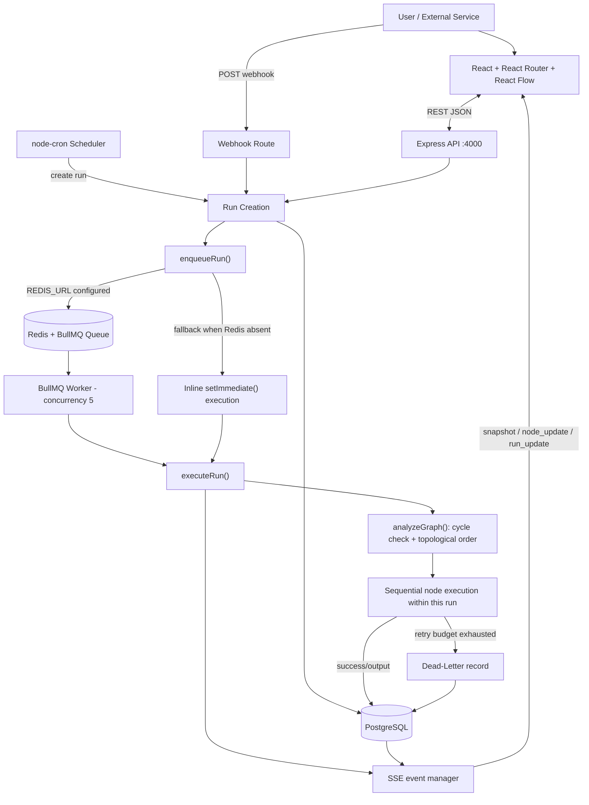
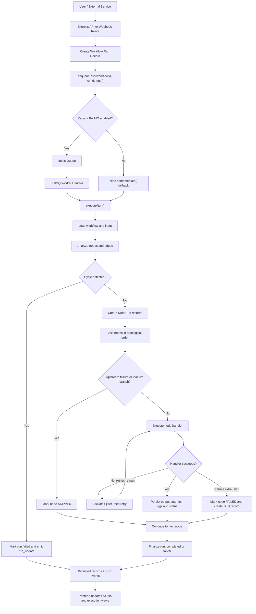
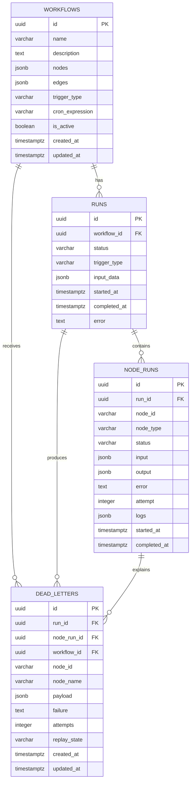

<div align="center">

# NODEVERSE — The Dormammu Loop

### Distributed DAG Workflow & Automation Engine

**Design. Validate. Execute. Observe. Recover.**

A visual automation platform for building dependency-driven workflows as Directed Acyclic Graphs (DAGs), validating their structure, executing nodes in dependency order, and inspecting run history and failures.

[](https://github.com/shreyanshmaurya4653-byte/NODEVERSE)
[](https://github.com/shreyanshmaurya4653-byte/NODEVERSE)
[](https://github.com/shreyanshmaurya4653-byte/NODEVERSE)
[](https://react.dev/)
[](https://vitejs.dev/)
[](https://nodejs.org/)
[](https://bullmq.io/)

**Problem Statement 04 · WEBSTER 2026 · Code Sangam 2026**

[View Repository](https://github.com/shreyanshmaurya4653-byte/NODEVERSE) · [Report an Issue](https://github.com/shreyanshmaurya4653-byte/NODEVERSE/issues)

</div>

---

## Table of Contents

- [Project at a Glance](#-project-at-a-glance)
- [Problem Statement](#-problem-statement)
- [Objective and Proposed Solution](#-objective-and-proposed-solution)
- [What Is a DAG?](#-what-is-a-dag)
- [Website Preview](#-website-preview)
- [Key Features](#-key-features)
- [Supported Node Types](#-supported-node-types)
- [System Architecture](#-system-architecture)
- [Workflow Execution: Step by Step](#-workflow-execution-step-by-step)
- [DAG Validation Algorithm](#-dag-validation-algorithm)
- [Execution State and Recovery](#-execution-state-and-recovery)
- [Data Model](#-data-model)
- [REST API Reference](#-rest-api-reference)
- [Technology Stack and Why It Is Used](#-technology-stack-and-why-it-is-used)
- [Getting Started](#-getting-started)
- [Environment Configuration](#-environment-configuration)
- [Tests and Verification](#-tests-and-verification)
- [Implementation Status and Known Limitations](#-implementation-status-and-known-limitations)
- [Security and Production-Hardening Roadmap](#-security-and-production-hardening-roadmap)
- [Tool and API Disclosure](#-tool-and-api-disclosure)
- [Team ORCHANOVA](#-team-orchanova)
- [Deliverables and Future Work](#-deliverables-and-future-work)
- [License](#-license)

---

## 🚀 Project at a Glance

| Field | Details |
|---|---|
| **Project name** | NODEVERSE — The Dormammu Loop |
| **Category** | Visual workflow automation / DAG orchestration |
| **Problem statement** | Problem Statement 04 — WEBSTER 2026 |
| **Team** | ORCHANOVA |
| **Team ID** | 390 |
| **Repository** | [shreyanshmaurya4653-byte/NODEVERSE](https://github.com/shreyanshmaurya4653-byte/NODEVERSE) |
| **Frontend** | React, Vite, React Router, React Flow (`reactflow`) |
| **Backend** | Node.js, Express |
| **Persistence** | PostgreSQL through `pg`, with an in-memory demo fallback |
| **Queue** | Redis + BullMQ when `REDIS_URL` is configured; inline fallback otherwise |
| **Scheduling** | `node-cron` |
| **Live updates** | Server-Sent Events (SSE) |

> **Project scope note:** this repository contains a working prototype with real graph validation and workflow execution logic, alongside demo implementations for a few integration nodes. This README distinguishes code that is present from capabilities that still require production hardening.

## 🎯 Problem Statement

Many automation tasks consist of smaller operations that depend on one another. For example, an order-processing pipeline may need to receive a webhook, normalize the incoming order, evaluate a condition, pause for a defined interval, and then send the order to the appropriate fulfillment path.

When these steps are represented only as a linear script or as loosely connected background jobs, it becomes harder to see dependencies, prevent invalid execution order, understand a failed step, and recover safely from repeat failures.

**The Dormammu Loop** addresses this problem by representing a workflow as a graph. Each node is a task, and each directed edge describes a dependency. Before execution, the system analyzes the graph, rejects cyclic workflows, computes a topological order, passes task outputs downstream, records run telemetry, and exposes failure records for review.

### The objective

Build a visual DAG workflow engine that can:

- Let users design and configure workflows on a visual canvas.
- Validate graph structure before execution and prevent cyclic dependencies.
- Trigger workflows manually, through an inbound webhook, or on a cron schedule.
- Execute nodes according to dependency order and support conditional branching.
- Record run-level and node-level status, input, output, errors, attempts, timestamps, and logs.
- Recover from eligible node failures with bounded retries and route exhausted failures to a Dead-Letter Queue (DLQ).
- Stream run and node updates to the interface while execution is in progress.

## 💡 Objective and Proposed Solution

NODEVERSE combines a visual workflow editor with a custom execution engine rather than relying on an external workflow engine to perform the core DAG logic.

| Layer | Responsibility | Why it matters |
|---|---|---|
| **Visual Studio** | Build, connect, configure, inspect, and arrange workflow nodes. | Makes dependencies understandable before a run starts. |
| **Graph validator** | Analyze nodes and edges, reject cycles, and return a topological ordering for valid graphs. | Prevents dependency loops and establishes a valid execution sequence. |
| **Execution engine** | Resolve each node's input from upstream output, run the handler, and route conditional branches. | Gives the workflow predictable, traceable behavior. |
| **Queue and worker handler** | Use Redis/BullMQ when configured to accept run jobs and process them with a configured concurrency of five. | Separates run submission from queued execution; the current bootstrap still creates the worker in the API process. |
| **Persistence layer** | Store workflows, runs, node runs, and dead-letter records in PostgreSQL when configured. | Provides a structured record of execution history. |
| **Telemetry and recovery** | Emit SSE events, persist logs/status, retry eligible failures, and expose DLQ replay/discard actions. | Helps operators understand and respond to failed work. |

## 🧠 What Is a DAG?

A **Directed Acyclic Graph (DAG)** is a set of nodes connected by directed edges, with no directed path that loops back to a node already visited.

- **Node:** an operation, such as a trigger, transformation, HTTP request, or condition.
- **Edge:** a directed dependency from one node to another.
- **Dependency:** a node should not run until the relevant upstream node has completed successfully.
- **Acyclic constraint:** a workflow must not contain a directed cycle, because that would make a simple dependency-driven execution order impossible.
- **Topological order:** a sequence in which each node appears after its dependencies.

Example:

```text
Webhook Trigger
      │
      ▼
Normalize Order
      │
      ▼
VIP Condition ───────┐
   TRUE               FALSE
    │                   │
    ▼                   ▼
Priority Delay     Standard Fulfillment
    │
    ▼
Priority Notification
```

The visual editor uses React Flow to render and connect nodes. The backend owns graph analysis and the execution rules; the canvas is not the authority on whether a graph is valid.

## 🖥️ Website Preview

### 1. NODEVERSE landing page

The landing page introduces the platform, explains the workflow concept, and presents a visual workflow example.


### 2. Workflow Studio / DAG editor

The Studio provides the node palette, graph canvas, workflow controls, branch connections, layout controls, and an execution-log area.


> Screenshots are demonstrations of the interface. The current source tree also contains known integration gaps described in [Implementation Status and Known Limitations](#-implementation-status-and-known-limitations).

## ✨ Key Features

### Visual workflow authoring

- React Flow canvas with draggable nodes and editable directed connections.
- Pan, zoom, fit-view and layout controls.
- Node-specific configuration for triggers, HTTP calls, transforms, conditions, delays, and additional utility/integration node types.
- Workflow listing, templates, duplicate/toggle/delete actions, and workflow editor routes.

### Graph validation and deterministic ordering

- Backend graph analysis is implemented in `server/src/executor.js` and shared with workflow-validation routes.
- Kahn's algorithm is used to build a topological order.
- Cycles cause validation to fail and prevent execution.
- Condition nodes return a `true` or `false` branch; edges can use branch handles to select a path.
- Nodes can be marked `skipped` when an upstream dependency fails or an edge belongs to an unselected conditional branch.

### Triggering and scheduling

- **Manual trigger:** run a saved workflow from the interface or the workflow trigger endpoint.
- **Webhook trigger:** `POST /webhooks/:workflowId` accepts a JSON payload for active workflows configured for webhook triggering.
- **Cron trigger:** `node-cron` schedules active workflows with valid cron expressions and creates runs when due.

### Execution history and live telemetry

- Workflow run records and node-run records include statuses and timing fields.
- Node-level logs capture execution steps and retry attempts.
- A run's event stream sends an initial snapshot and subsequent named SSE events.
- The UI includes run history, webhook management, templates, an operational console, and a DLQ workspace.

### Bounded retries and Dead-Letter Queue

- A node can configure `maxRetries`, `baseDelayMs`, and `maxDelayMs`.
- Retries use exponential backoff plus random jitter.
- When a node exhausts its configured attempts, the executor creates a DLQ record containing contextual workflow/node information, the input payload, failure message, and attempt count.
- The interface/API supports listing, inspecting, replaying, and discarding DLQ records.

### AI-assisted workflow creation

- `POST /api/workflows/generate` attempts Gemini-based prompt-to-workflow generation when `GEMINI_API_KEY` is available.
- When live generation is unavailable, the route falls back to a built-in rule-based workflow synthesizer.
- The AI Agent node can use supported configured providers/endpoints where credentials are supplied; it also has a deterministic built-in fallback for demos.

## 🧩 Supported Node Types

The frontend registers the following node types, with the execution map defined in `server/src/executor.js`.

| Node type | Purpose | Implementation note |
|---|---|---|
| `trigger` | Start a workflow and merge configured trigger payload with incoming input. | Supports manual, webhook, and cron trigger metadata. |
| `http` | Send an HTTP request and return response status, duration, and parsed response data. | Outbound request safeguards still need hardening. |
| `transform` | Transform JSON-like input using a configured JavaScript expression. | Uses dynamic JavaScript evaluation; not a security sandbox. |
| `condition` | Evaluate a condition and return a branch result. | `true`/`false` edge handles drive branch selection. |
| `delay` | Pause execution for a configured delay. | Delay is clamped to a range of 50 ms to 30 seconds. |
| `webhook_out` | Post a notification payload to a configured endpoint. | Basic outbound webhook behavior; delivery verification should be improved. |
| `scraper` | Fetch a web page and extract title, description, headings, and links. | Uses lightweight HTML matching, not a full DOM parser. |
| `app_connector` | Execute an HTTP-style connector request. | Generic HTTP adapter, not a full set of authenticated native integrations. |
| `ai_agent` / `llm` | Analyze input with a configured AI endpoint or the built-in fallback. | Output depends on provider configuration and fallback path. |
| `filter` | Filter input items with simple field/operator comparisons. | Supports equality, containment, numeric comparisons, and empty checks. |
| `code` | Execute user-configured JavaScript. | Runs using `new Function`; it must not be treated as isolated untrusted-code execution. |
| `email` | Prepare an email-like output record. | **Demo/simulated:** no SMTP client is configured in this source. |
| `database` | Produce database-query-shaped output for a configured operation. | **Demo/simulated:** currently returns sample data; it does not execute SQL against a user database. |
| `date_time` | Format, parse, or adjust date/time values. | Utility handler. |
| `crypto` | Generate UUIDs, hashes, and base64 encodings/decodings. | Uses Node.js crypto utilities. |
| `merge` | Combine upstream data or append array-like data. | Multiple parent outputs are collected by source node ID. |
| `slack` | Post a message through a configured Slack incoming webhook. | Basic webhook handler; response-status validation and delivery guarantees need improvement. |

## 🏗️ System Architecture

### High-level architecture



**Important deployment detail:** the current `server/src/index.js` calls `initQueue()` inside the API process, and `server/src/queue.js` constructs the BullMQ `Worker` there. Therefore, the current code uses a queue-backed worker object, but it does **not yet deploy the worker as an independent service/process**. The next production step is to split API and worker bootstrapping into separate entry points.

### Backend responsibilities

| Module | Responsibility |
|---|---|
| `server/src/index.js` | Configure Express middleware, mount routes, initialise database/queue/scheduler, expose `/health`, and optionally serve `client/dist`. |
| `server/src/routes/workflows.js` | Workflow CRUD, validation, trigger handling, node testing, workflow generation, and refinement helper endpoint. |
| `server/src/routes/runs.js` | Run listing/details, node-run listing, status cancellation endpoint, and SSE stream endpoint. |
| `server/src/routes/webhooks.js` | Validate webhook workflow existence/active state/type, create a run, and submit it for execution. |
| `server/src/routes/deadLetters.js` | Query DLQ records, replay a payload as a new workflow run, and discard a record. |
| `server/src/routes/stats.js` | Aggregate workflow, run, and DLQ counters. |
| `server/src/executor.js` | Graph analysis, node handlers, input/output propagation, branch handling, retry policy, and run finalisation. |
| `server/src/queue.js` | Initialise Redis/BullMQ if available, register the worker handler, and enqueue or inline-dispatch runs. |
| `server/src/scheduler.js` | Load active cron workflows on startup and register/replace/stop schedules. |
| `server/src/sse.js` | Track subscribers and broadcast run/node/dead-letter events. |
| `server/src/db.js` | Database abstraction, PostgreSQL schema creation, CRUD operations, in-memory fallback, seed data, and workflow-file fallback persistence. |

### Frontend responsibilities

| Location | Responsibility |
|---|---|
| `client/src/main.jsx` | React entry point, router bootstrap, stylesheet import, and top-level error boundary. |
| `client/src/App.jsx` | Route definitions for landing page, console, workflow list/editor, runs, DLQ, webhooks, and templates. |
| `client/src/pages/WorkflowEditor.jsx` | Main workflow-building canvas, controls, node configuration, and execution interactions. |
| `client/src/components/nodes/index.jsx` | Custom visual node components and registered node types. |
| `client/src/api/index.js` | Fetch-based API client and SSE EventSource helper. |
| `client/src/pages/RunHistory.jsx` | Run history/detail and live status subscription. |
| `client/src/pages/DeadLetterQueue.jsx` | DLQ inspection, replay, and discard interface. |
| `client/src/pages/Templates.jsx` | Workflow template browsing. |
| `client/src/pages/WebhookHub.jsx` | Webhook-related workflow tooling. |
| `client/src/pages/Dashboard.jsx` | Workflow listing and management interface. |
| `client/src/index.css` | Application styling and design system. |

### Repository structure

```text
NODEVERSE/
├── README.md
├── package.json                 # Root development scripts
├── .gitignore
├── docs/
│   └── screenshots/
│       ├── nodeverse-landing.png
│       └── nodeverse-studio.png
├── client/
│   ├── package.json
│   ├── package-lock.json
│   ├── index.html
│   ├── vite.config.js
│   └── src/
│       ├── api/index.js
│       ├── components/
│       ├── pages/
│       ├── App.jsx
│       ├── main.jsx
│       └── index.css
├── server/
│   ├── package.json
│   ├── package-lock.json
│   ├── .env.example
│   ├── test-unit.js
│   └── src/
│       ├── routes/
│       ├── db.js
│       ├── executor.js
│       ├── index.js
│       ├── queue.js
│       ├── scheduler.js
│       └── sse.js
└── legacy-prototype/             # Earlier standalone HTML/CSS/JS prototype
```

Keep the main project root as the single `NODEVERSE/` directory. The supplied ZIP contains a duplicate nested `NodeVerse/NodeVerse/` copy in addition to the active root; do not upload that duplicate folder into the GitHub repository.

## 🔄 Workflow Execution: Step by Step

The diagram below describes the execution path implemented in the current source, including the Redis-backed path and the development fallback.



### Execution semantics

1. **A trigger creates a run.** The API stores a run record and passes the workflow ID, run ID, and input payload to `enqueueRun()`.
2. **The queue path is selected.** With `REDIS_URL`, BullMQ receives a job and its worker handler calls `executeRun()`. Without Redis, the queue module dispatches execution asynchronously in the same Node.js process.
3. **The graph is analysed before nodes run.** The executor reads the workflow's nodes/edges, rejects an empty workflow, marks the run as running, and evaluates cycle/topological order.
4. **Node-run records are created.** The engine creates a record for each node in the planned ordering so the run has per-node telemetry.
5. **Inputs are resolved.** A root node receives the run input. A node with one incoming edge receives that parent's output. A node with multiple incoming edges receives an object keyed by upstream node ID.
6. **Branch and dependency rules are applied.** Nodes whose upstream dependency failed or was skipped are skipped. Edges leaving a condition node can specify `sourceHandle: "true"` or `sourceHandle: "false"`; the unselected path is skipped.
7. **The node handler runs.** The selected handler produces output or throws an error. Logs, timestamps, attempt count, and status are written to the node-run record and streamed through SSE.
8. **A failed handler may retry.** Retry settings are read from the node configuration. When the retry budget is exhausted, a DLQ record is created and the failed node's downstream dependants are skipped; unrelated nodes may still be evaluated.
9. **The run is finalised.** The run status becomes `failed` if any node failed, otherwise `completed`, and a final run update is emitted.

> **Concurrency clarification:** BullMQ's worker is configured with `concurrency: 5`, which allows queued run jobs to be processed concurrently. Within a single workflow run, the current executor uses a `for` loop over the topological order and executes nodes **sequentially**, not in parallel. Independent-node parallel scheduling is a potential future improvement.

## 🧮 DAG Validation Algorithm

The graph analysis function is `analyzeGraph(nodes, edges)` in `server/src/executor.js`.

### Kahn's algorithm used by the executor

1. Create an in-degree count for each node and an adjacency list for directed edges.
2. Place every node with in-degree zero into a queue.
3. Repeatedly remove a zero-in-degree node, append it to the topological result, and decrement the in-degree of its outgoing neighbours.
4. Add a neighbour to the queue when its in-degree becomes zero.
5. Compare the number of processed nodes with the number of input nodes.
   - If all nodes were processed, the graph has a valid topological order.
   - If some nodes remain, a cycle exists in the graph or in the dependency region affected by it; validation fails.

The validation API returns `valid`, `hasCycle`, `cycleTrace`, `topologicalOrder`, `nodeCount`, and `edgeCount`.

**Implementation precision note:** `cycleTrace` currently contains node IDs left outside the topological result. It is useful for locating the affected graph region, but it is not guaranteed to be a minimal, ordered cycle path. A future enhancement could add DFS-based cycle-path reconstruction for a more precise diagnostic.

## 📡 Execution State and Recovery

### Run and node statuses

| Entity | Statuses used in the current backend | Meaning |
|---|---|---|
| Workflow run | `pending`, `running`, `completed`, `failed`, `cancelled` | Overall lifecycle for a workflow execution. |
| Node run | `pending`, `running`, `completed`, `failed`, `skipped` | Per-node progress, including dependency/branch skips. |
| Dead letter | `pending`, `replayed`, `discarded` | Whether an exhausted failure remains available for operator action. |

### Retry policy

Node configuration may provide:

- `maxRetries` — number of retries after the first attempt. If omitted, the current default is **zero retries** (one total attempt).
- `baseDelayMs` — initial backoff base; current fallback value is 500 ms.
- `maxDelayMs` — maximum backoff cap; current fallback value is 8,000 ms.
- Random jitter — currently up to approximately 149 ms is added to retry delays.

The current retry-delay calculation is effectively:

```text
backoff = min(baseDelayMs × 2^(attempt − 2) + jitter, maxDelayMs)
```

This retry loop is implemented by the workflow executor. BullMQ jobs themselves are configured with `attempts: 1`; repeated node execution is not delegated to BullMQ's own retry policy.

### Dead-Letter Queue (DLQ)

When a node uses all configured attempts and still fails, the executor records the workflow/run/node identifiers, node name, input payload, failure message, and number of attempts. The DLQ API supports:

- Listing records, optionally filtered by replay state.
- Inspecting an individual record.
- Replaying the original payload as a **new workflow run**.
- Discarding a record from further operator consideration.

Replay creates a new run rather than resuming the exact failed node checkpoint. External side effects can repeat during replay, so workflows that send messages, make payments, or mutate external systems need idempotency protection before production use.

### Live execution with SSE

The route `GET /api/runs/:id/stream` opens a Server-Sent Events connection. The server sends an initial `snapshot` and publishes events including:

- `node_update` — a node-run record changed.
- `run_update` — a workflow run changed.
- `dead_letter_created` — a new DLQ record was created.

SSE is a one-way server-to-browser channel, which fits live progress updates without a full-duplex WebSocket connection.

## 🗃️ Data Model

PostgreSQL tables are created by `migrate()` in `server/src/db.js` when `DATABASE_URL` is configured and the database is reachable.



### Persistence behavior

- **PostgreSQL configured and reachable:** the backend creates the tables if necessary and uses PostgreSQL for workflow/run/node-run/DLQ operations.
- **PostgreSQL not configured or unreachable:** the backend falls back to in-memory maps and seeds demo data. It attempts to write workflow definitions to a JSON file path derived from `server/workflows-store.json` relative to the process working directory.
- **Working-directory caveat:** because that fallback file path is currently working-directory-dependent, verify or fix the path relative to `import.meta.url` before relying on file persistence under every launch command.
- **Important fallback limitation:** run, node-run and dead-letter maps are in memory in fallback mode. They are not a replacement for durable PostgreSQL records across process restarts.

## 🔌 REST API Reference

The Express API defaults to `http://localhost:4000`.

### Health

| Method | Endpoint | Purpose |
|---|---|---|
| `GET` | `/health` | Basic service status, service name, team ID, and timestamp. |

### Workflows

| Method | Endpoint | Purpose |
|---|---|---|
| `GET` | `/api/workflows` | List workflow definitions. |
| `POST` | `/api/workflows` | Create a workflow. |
| `GET` | `/api/workflows/:id` | Fetch one workflow. |
| `PUT` | `/api/workflows/:id` | Update a workflow and refresh its schedule when applicable. |
| `PATCH` | `/api/workflows/:id/toggle` | Toggle active state and cron scheduling. |
| `POST` | `/api/workflows/:id/duplicate` | Duplicate a workflow as an inactive copy. |
| `DELETE` | `/api/workflows/:id` | Delete a workflow and unschedule it. |
| `POST` | `/api/workflows/:id/trigger` | Create and dispatch a manual run. |
| `POST` | `/api/workflows/validate` | Validate supplied nodes/edges and return a topological order if valid. |
| `POST` | `/api/workflows/:id/validate` | Validate supplied graph data or the saved workflow graph. |
| `POST` | `/api/workflows/generate` | Generate a workflow from a natural-language prompt. |
| `POST` | `/api/workflows/ai-refine` | Return a helper-generated node-field refinement. |
| `POST` | `/api/workflows/test-node` | Run an isolated node handler with supplied config and input. |

### Runs and live events

| Method | Endpoint | Purpose |
|---|---|---|
| `GET` | `/api/runs` | List runs; supports `workflowId`, `limit`, and `offset` query parameters. |
| `GET` | `/api/runs/:id` | Fetch a run and its node-run records. |
| `GET` | `/api/runs/:id/node-runs` | List node runs for one workflow run. |
| `POST` | `/api/runs/:id/cancel` | Mark a run as cancelled. See the limitation below. |
| `GET` | `/api/runs/:id/stream` | Open a live SSE stream for a run. |

**Cancellation limitation:** the current endpoint updates the run's status, but the node execution loop does not yet poll a cancellation token to stop in-flight work cooperatively. Treat cancellation as a recorded state change until cancellation checks are implemented in the executor.

### Webhooks, DLQ, and statistics

| Method | Endpoint | Purpose |
|---|---|---|
| `POST` | `/webhooks/:workflowId` | Receive a JSON payload and start an active workflow configured for webhook triggering. Returns HTTP `202` after submission. |
| `GET` | `/api/dead-letters` | List DLQ records; optionally filter with `replayState`. |
| `GET` | `/api/dead-letters/:id` | Fetch one DLQ record. |
| `POST` | `/api/dead-letters/:id/replay` | Create a new run from the stored payload. |
| `POST` | `/api/dead-letters/:id/discard` | Mark a DLQ record as discarded. |
| `GET` | `/api/stats` | Return workflow/run/DLQ statistics. |

### Example: validate a graph

```bash
curl -X POST http://localhost:4000/api/workflows/validate \
  -H "Content-Type: application/json" \
  -d '{
    "nodes": [{"id":"start"},{"id":"finish"}],
    "edges": [{"id":"e1","source":"start","target":"finish"}]
  }'
```

### Example: trigger a webhook workflow

Replace `WORKFLOW_ID` with the ID of a saved workflow whose `trigger_type` is `webhook` and whose `is_active` flag is true.

```bash
curl -X POST http://localhost:4000/webhooks/WORKFLOW_ID \
  -H "Content-Type: application/json" \
  -d '{"orderId":"ORD-1001","amount":249.50,"customer":"Demo User"}'
```

## 🧰 Technology Stack and Why It Is Used

| Technology | Role in NODEVERSE | Rationale |
|---|---|---|
| **React 18** | Component-based frontend. | Keeps the dashboard, editor, node views, and operational screens modular. |
| **Vite 5** | Frontend dev server and build tool. | Fast development feedback and static production build output. |
| **React Router 6** | Client-side routing. | Separates landing page, editor, templates, executions, webhooks, and DLQ screens. |
| **React Flow (`reactflow`)** | Visual graph canvas. | Supplies node/edge rendering and graph-canvas interaction primitives. |
| **Lucide React** | UI icons. | Consistent interface iconography. |
| **Node.js + Express** | REST API and webhook ingress. | Lightweight JavaScript service layer shared conceptually with the frontend ecosystem. |
| **PostgreSQL + `pg`** | Relational persistence. | Stores workflows, run records, node telemetry, and DLQ records when configured. |
| **Redis + BullMQ + ioredis** | Queue-backed run dispatch. | Allows the application to submit run jobs and configure worker concurrency. |
| **node-cron** | Schedule trigger registration. | Runs active cron workflows on configured schedules. |
| **Server-Sent Events** | Live event delivery. | Streams one-way status/log updates to connected browser clients. |
| **node-fetch** | Outbound HTTP calls. | Used by HTTP, scraping, webhook, and related node handlers. |
| **dotenv** | Environment loading. | Loads local service and optional API-key configuration. |
| **Docker Compose** | Initial design/development goal. | The abstract proposes a repeatable service environment; the active source root in the supplied archive does not currently include a ready-to-run `docker-compose.yml`, so the documented setup below uses npm scripts. |

## 🏁 Getting Started

### Prerequisites

- Node.js 18 or later and npm.
- A terminal (PowerShell, Windows Terminal, macOS Terminal, or Linux shell).
- Optional for durable/queued mode: PostgreSQL and Redis running locally or reachable through connection URLs.

### 1. Get the repository

```bash
git clone https://github.com/shreyanshmaurya4653-byte/NODEVERSE.git
cd NODEVERSE
```

If you already have the repository locally, open a terminal in the repository root — the directory containing the root `package.json`, `client/`, and `server/` folders.

### 2. Install dependencies

```bash
npm install
npm run install:all
```

The root package installs the development runner (`concurrently`). The `install:all` script installs the client and server dependencies separately.

### 3. Configure the backend environment

Create `server/.env` using the template in [`server/.env.example`](server/.env.example). For the simplest local demo, leave `DATABASE_URL` and `REDIS_URL` unset; the code will select its in-memory and inline-execution fallbacks.

macOS / Linux:

```bash
cp server/.env.example server/.env
```

Windows PowerShell:

```powershell
Copy-Item server/.env.example server/.env
```

### 4. Start the application

```bash
npm run dev
```

The root script starts the frontend and backend together.

| Service | Local address |
|---|---|
| Frontend (Vite) | [http://localhost:5173](http://localhost:5173) |
| Backend API | [http://localhost:4000](http://localhost:4000) |
| Health check | [http://localhost:4000/health](http://localhost:4000/health) |

Vite proxies `/api`, `/webhooks`, and `/health` requests to the backend during development.

### 5. Build the frontend

```bash
npm run build
```

This runs the client Vite production build and writes output to `client/dist/`. The backend can serve that folder when it exists, but the supplied root does not include a combined production deployment script.

## ⚙️ Environment Configuration

See [`server/.env.example`](server/.env.example) for a safe template. The main variables are:

| Variable | Required? | Purpose |
|---|---|---|
| `PORT` | No | Backend port; defaults to `4000`. |
| `CLIENT_URL` | Recommended outside local development | CORS origin for the frontend. If omitted, current backend configuration falls back to `*`. |
| `DATABASE_URL` | Optional for demo mode; recommended for persisted runs | PostgreSQL connection string. If unset/unreachable, the application falls back to in-memory storage. |
| `REDIS_URL` | Optional for demo mode; recommended for queued mode | Redis connection string for BullMQ. If unset/unreachable, run execution falls back inline. |
| `GEMINI_API_KEY` | Optional | Enables Gemini-backed workflow generation and may be used by AI Agent configuration. |
| `OPENAI_API_KEY` | Optional | AI Agent configuration for compatible OpenAI API usage. |
| `DEEPSEEK_API_KEY` | Optional | AI Agent provider configuration. |
| `GROQ_API_KEY` | Optional | AI Agent provider configuration. |
| `ANTHROPIC_API_KEY` | Optional | AI Agent provider configuration. |

Do not commit real API keys or passwords. If a real secret was ever committed to Git history, deleting the file in a later commit is not sufficient; rotate the secret and remove it from repository history as appropriate.

## ✅ Tests and Verification

Run the backend's current test/smoke script with:

```bash
npm test --prefix server
```

The existing `server/test-unit.js` exercises database initialisation/fallback, statistics and workflow listing, graph ordering/cycle cases, dead-letter listing, and creation of a sample run record.

**Test scope honesty:** this script is not a complete end-to-end suite and does not execute a full set of node handlers, prove crash recovery, or perform a load test. No verified throughput, webhook p50/p95 latency, or concurrency benchmark is included in the supplied repository. Performance claims should be added only after repeatable measurements have been run and documented with test environment details.

## ⚠️ Implementation Status and Known Limitations

The items below reflect the supplied source code and should be addressed before describing the project as production-ready.

| Area | Current source behavior | Consequence / next step |
|---|---|---|
| Worker isolation | BullMQ `Worker` is created by `initQueue()` from the API server startup path. | Split API and worker into separate processes/services for stronger isolation and independent scaling. |
| Intra-workflow parallelism | Nodes run sequentially in topological order inside `executeRun()`. | Add dependency-ready scheduling if parallel execution of independent nodes is required. |
| PostgreSQL fallback | In-memory maps are used if the DB is absent or unreachable; workflow definitions can be written to `server/workflows-store.json`. Run/node-run/DLQ fallback records are in memory. | Use PostgreSQL for durable execution history and configure backup/monitoring. |
| Queue fallback | With no Redis, runs execute inline using `setImmediate`. | This is convenient for local demos, but does not provide durable queueing or distributed recovery. |
| Retry defaults | A node has no retries by default unless `maxRetries` is configured. | Set per-node retry caps and confirm error classes are safe to retry. |
| Idempotency | The abstract describes idempotency as a design goal, but a durable idempotency-key guard is not established by the reviewed executor/queue path. | Add idempotency keys and transactional enqueue/state transitions before production use. |
| Cancellation | The cancel endpoint updates a run record, but the execution loop does not check a cancellation signal. | Add cooperative cancellation checks to the executor and worker handler. |
| Email node | Builds a message-like result and message ID. | Integrate and verify a real mail transport before treating it as delivered. |
| Database node | Returns demo rows/results rather than executing against a configured external database. | Implement a credentialed DB adapter with parameterised queries, access controls, and timeouts. |
| AI assistance | Live providers depend on keys/config; fallback reasoning/generation is deterministic and rule-based. | Label fallback outputs clearly and validate generated graphs before saving/executing. |
| AI refinement | `ai-refine` uses deterministic helper/template logic in the current source. | Do not describe that endpoint itself as an LLM call. |
| App connectors | `app_connector` delegates to the generic HTTP handler. | Provider-specific auth, scopes, rate limits, and response validation remain integration work. |
| Cycle diagnostics | Kahn's algorithm identifies the leftover graph region, not necessarily the minimal ordered cycle. | Add a DFS cycle trace for more precise user-facing diagnostics. |
| Run cancellation API/UI | The backend status mutation does not stop an active node handler. | Distinguish “cancel requested” from “execution halted” until implemented. |
| App Console API calls | In the supplied `AppConsole.jsx`, calls reference `api.getWorkflows()`, `api.getRuns()`, and `api.runWorkflow()`, while the API client exports `listWorkflows()`, `listRuns()`, and `triggerWorkflow()`. | Align these method names before relying on the Console view during an end-to-end demo. |
| Load testing | No load-test harness/results were present in the supplied source tree. | Benchmark webhook submission latency, queue wait, run throughput, error recovery and resource usage under documented load. |

## 🔐 Security and Production-Hardening Roadmap

Custom workflow engines execute user-supplied configuration and can make outbound network calls, so isolation and permissions are essential. The current prototype should be treated as a local evaluation/demo application, not an internet-facing multi-tenant service.

- [ ] **Isolate custom JavaScript.** `transform` and `code` handlers use `new Function`; this is not a security sandbox. Use a restricted runtime/process with CPU, memory, and wall-clock limits, or disable arbitrary code for untrusted users.
- [ ] **Add authentication and authorisation.** Protect workflow CRUD, run history, execution, DLQ replay/discard and secret-management endpoints.
- [ ] **Harden webhook ingress.** Add per-workflow secrets or signatures, payload size/rate limits, abuse controls, and replay protection.
- [ ] **Constrain outbound requests.** Validate schemes and hosts, block private/link-local/metadata ranges as appropriate, re-check redirects, and add connection/read timeouts and response-size limits to mitigate SSRF and resource exhaustion.
- [ ] **Protect credentials.** Use a dedicated secret store or encrypted credential records; redact secrets and sensitive payload fields from logs; never place production keys in workflow JSON or public commits.
- [ ] **Make state transitions safe.** Add database transactions/outbox or equivalent safeguards around run creation and job enqueueing, and durable idempotency keys for side-effecting nodes.
- [ ] **Separate worker runtime.** Deploy API and worker as independent processes/services; define graceful shutdown, worker health, stalled-job detection, and restart/recovery behavior.
- [ ] **Validate external integrations.** Add real SMTP and database drivers only with explicit credentials, least-privilege permissions, parameterised queries, and observable delivery outcomes.
- [ ] **Strengthen API controls.** Configure explicit CORS origins, authentication, request validation, rate limits, and safe error responses.
- [ ] **Add automated tests.** Cover cycles, malformed edges, branching, multiple parents, retry caps, repeated delivery, crash/restart recovery, cancellation, DLQ replay, and API integration.
- [ ] **Publish reproducible benchmarks.** Measure webhook acknowledgment latency (including p50/p95), run throughput, concurrent queued runs, queue delay, retry behavior and resource consumption; record host specs, payload, node count and test duration.

## 🧾 Tool and API Disclosure

The project brief asks teams to disclose tools and document execution-engine/load-test evidence. For transparency, the source currently uses the following:

- **Core implementation:** custom JavaScript graph-analysis and workflow-execution logic in this repository.
- **Frontend libraries:** React, Vite, React Router, React Flow, and Lucide React.
- **Backend libraries/services:** Express, PostgreSQL via `pg`, Redis/BullMQ via `ioredis`, `node-cron`, `node-fetch`, and `dotenv`.
- **AI API use:** Gemini is called for prompt-to-workflow generation when `GEMINI_API_KEY` is provided. The AI Agent handler supports provider/endpoint configuration for compatible APIs and may call configured external services. Requests to external LLMs transmit the prompt and input context supplied to that node; configure data handling accordingly.
- **Offline/deterministic fallbacks:** prompt-to-workflow generation can fall back to a rule-based DAG synthesizer; the AI Agent can fall back to built-in heuristic output; the `ai-refine` endpoint is deterministic helper logic in the current code.
- **External actions:** HTTP requests, scraping, outbound webhooks and Slack webhooks may contact URLs configured by the workflow author. The email and database node handlers are demo/simulated in the reviewed source.
- **Performance evidence:** the repository currently contains a lightweight test script, but no reproducible load-test benchmark results. Do not claim sub-second webhook latency or a particular throughput until measured under documented conditions.

## 👥 Team ORCHANOVA

**Team ID: 390 · WEBSTER 2026 · Problem Statement 04**

| Team member | Registration number | Role |
|---|---:|---|
| **Shreyansh Maurya** | `20253278` | Team Lead · Frontend |
| **Shravan Kumar Jaiswal** | `20253275` | Backend Engineering |
| **Darsheel Singh** | `20253085` | Backend Engineering |

The team is building NODEVERSE around a project-owned DAG validation and execution engine, with the visual editor and operational screens providing the interface for designing and observing workflows.

## 📦 Deliverables and Future Work

### Current repository deliverables

- Visual workflow editor and operational UI.
- Backend API for workflow definitions, triggers, run history and DLQ actions.
- Kahn-based graph analysis and topological execution ordering.
- Conditional branch handling and downstream skip behavior.
- Node execution records, logs, retries, SSE status updates, and DLQ records.
- Cron and webhook trigger support.
- AI-assisted generation path with deterministic fallback.
- This README as architecture, setup, API, algorithm, limitations, and tool-disclosure documentation.

### Next recommended milestones

1. Resolve the App Console API-client method mismatch.
2. Add graph-validation test coverage for malformed edges and precise cycle paths.
3. Separate the worker from API startup and add health/recovery handling.
4. Add a safe JavaScript execution boundary and harden outbound network calls.
5. Replace demo email/database handlers with tested, permission-limited integrations.
6. Add durable idempotency and cooperative cancellation.
7. Add an automated integration test suite plus a reproducible load-test benchmark report.

## 📄 License

No `LICENSE` file was present in the supplied source archive. Add a license file before describing the repository as open-source under a specific license. Until then, all rights remain with the applicable authors by default.

---

<div align="center">

**NODEVERSE — The Dormammu Loop**  
*Build the graph. Validate the path. Execute with visibility. Recover with intent.*

[GitHub Repository](https://github.com/shreyanshmaurya4653-byte/NODEVERSE)

</div>
